# Final Report — Heart Disease MLOps Platform

**Course:** Machine Learning Operations (AIMLCZG523) · **Assignment 01** · **Marks:** 50
**Author:** Gangadhar C · **Date:** October 2026
**Repository:** https://github.com/gangadharrr/MLOPS-Assignment-1
**Evidence:** `reports/`, `screenshots/`, `models/`, MLflow experiment `heart-disease`

---

## 1. Introduction

This report documents an end-to-end MLOps solution for predicting heart-disease risk from
patient health data (UCI Heart Disease, Cleveland). The goal was not only a good classifier,
but a reproducible, tested, containerized and monitored *system* around it: acquisition and EDA →
tracked experiments → packaged model → CI/CD → Docker → Kubernetes → Prometheus/Grafana.

| Assignment task | Section | Primary evidence |
|---|---|---|
| 1. Data acquisition & EDA | §2 | `src/download_data.py`, `src/eda.py`, `reports/figures/01–05` |
| 2. Feature engineering & models | §3 | `src/preprocessing.py`, `src/train.py`, `models/metrics_summary.csv` |
| 3. Experiment tracking | §4 | MLflow experiment `heart-disease`, `screenshots/mlflow_*.png` |
| 4. Packaging & reproducibility | §5 | `models/model.pkl`, pinned `requirements*.txt`, `sample_request.json` |
| 5. CI/CD & automated testing | §6 | `tests/` (20 cases), `.github/workflows/ci.yml` |
| 6. Containerization | §7 | `Dockerfile`, `screenshots/docker_verification.txt` |
| 7. Production deployment | §8 | `k8s/*.yaml`, `screenshots/k8s_*.{png,txt}` |
| 8. Monitoring & logging | §9 | `docker-compose.yml`, `monitoring/`, `screenshots/grafana_dashboard.png` |
| 9. Documentation & reporting | §10–12, appendices | this report, `README.md`, architecture diagram |

**Headline result.** The selected model (Random Forest) reaches **test accuracy 0.869 / ROC-AUC 0.948**
on a 61-row held-out split, compared by nested 5-fold CV (ROC-AUC 0.895 ± 0.049) against a logistic
regression baseline (§3 explains why the two are statistically tied and how the winner was chosen).

---

## 2. Data Acquisition & EDA (Task 1)

### 2.1 Acquisition

`src/download_data.py` downloads the UCI Cleveland `processed.cleveland.data` file directly from the
UCI repository, assigns column names, and binarizes the target (original values 1–4 → 1 "disease",
0 stays 0). Output: `data/heart.csv` (committed so CI and reviewers can reproduce everything without
network access). The final dataset is **303 rows × 14 columns** (13 features + target) with a
**54.1% / 45.9%** no-disease/disease split — mildly imbalanced but workable without resampling.

### 2.2 Cleaning and missing values

Two columns contain missing values encoded as `?` in the raw file: `ca` (4 rows) and `thal` (2 rows).
Rather than dropping rows, imputation lives *inside* the model pipeline (§3): median for numeric,
most-frequent for categorical. This keeps the cleaning step deterministic and fold-safe (imputation
statistics are learned on training folds only), and it also covers missing values arriving at
prediction time.

### 2.3 Exploratory analysis

`src/eda.py` produces five figures into `reports/figures/`.

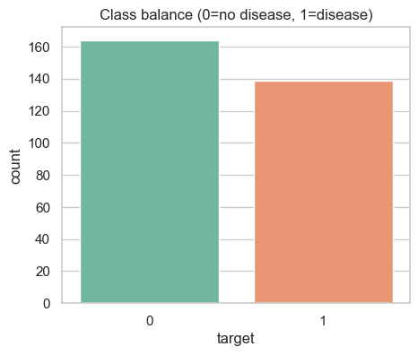
*Figure 1 — Class balance: 164 no-disease vs 139 disease (54.1% / 45.9%).*

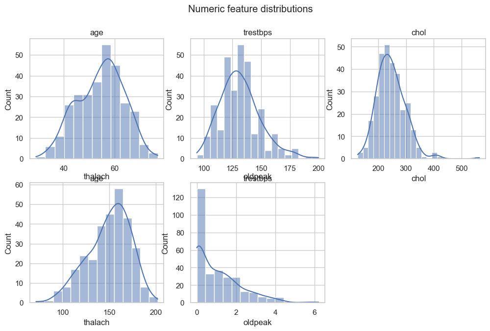
*Figure 2 — Feature histograms. `chol` and `oldpeak` are right-skewed; `thalach` (max heart rate) is roughly bell-shaped.*

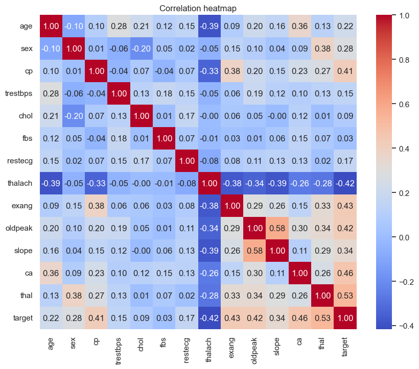
*Figure 3 — Correlation heatmap (teal = positive, orange = negative correlation with the target).*

Reading the heatmap (and the scatter/violin views in Figures 4–5):

- `thalach` (maximum heart rate achieved) is negatively associated with disease — lower max heart
  rate is a risk signal.
- `exang` (exercise-induced angina) and `oldpeak` (ST depression) are the strongest positive signals.
- `cp = typical angina` concentrates heavily in the disease class (Figure 5), while `cp = asymptomatic`
  is more mixed — clinically counter-intuitive but consistent with this dataset.
- `chol` is only weakly correlated with the target (a reminder that neither age nor cholesterol
  separates classes on their own in this dataset).

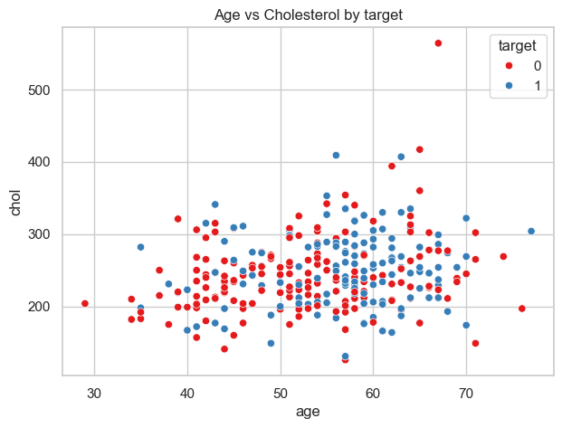
*Figure 4 — Age vs cholesterol by class.*

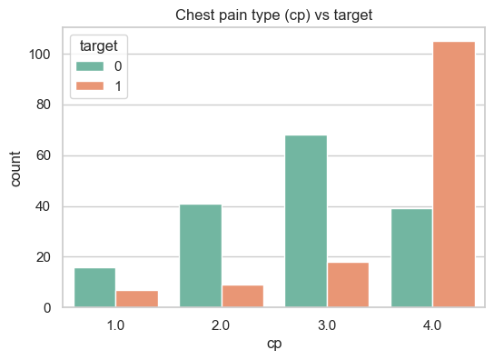
*Figure 5 — Chest-pain type vs target: typical angina is strongly associated with disease presence.*

---

## 3. Feature Engineering & Model Development (Task 2)

### 3.1 Preprocessing pipeline

All feature transformation is a single scikit-learn `ColumnTransformer` wrapped **inside** each model
pipeline (`src/preprocessing.py`), so training and serving apply byte-identical transforms:

| Feature group | Columns | Transform |
|---|---|---|
| Numeric (5) | `age, trestbps, chol, thalach, oldpeak` | median imputation + `StandardScaler` |
| Categorical (8) | `sex, cp, fbs, restecg, exang, slope, ca, thal` | most-frequent imputation + one-hot encoding |

Because the transformer travels inside `model.pkl` (§5), the FastAPI service needs no duplicated
preprocessing code — a classic source of train/serve skew.

### 3.2 Candidate models and tuning

Two classifier families were compared:

- **Logistic Regression** — interpretable linear baseline; grid `C ∈ {0.01, 0.1, 1, 10, 100}`.
- **Random Forest** — nonlinear interactions; grid `n_estimators ∈ {100, 300}` × `max_depth ∈ {3, 5, 8, None}` × `min_samples_leaf ∈ {1, 3}` (24 combinations).

### 3.3 Selection methodology (avoiding selection bias)

A common trap is to tune and pick a model on the same CV score, then quote that score as if it were
unbiased. This pipeline avoids it:

1. Stratified **80/20 split** (242 train / 61 test, seed 42). The test set is touched exactly once,
   for final reporting.
2. Each candidate is tuned with `GridSearchCV` using **inner 5-fold CV** (scoring = ROC-AUC).
3. Candidates are compared with **nested 5-fold CV** — the outer folds wrap the entire grid search —
   so the score used to pick the winner was never used to tune its hyperparameters.
4. The winner (highest nested-CV ROC-AUC) is refit on the full training split and saved.

### 3.4 Results

| Model | Nested-CV ROC-AUC (±sd) | CV accuracy | Test acc | Prec | Recall | Test ROC-AUC |
|---|---|---|---|---|---|---|
| Random Forest **(selected)** | **0.895 (±0.049)** | 0.797 | 0.869 | 0.833 | 0.893 | 0.948 |
| Logistic Regression | 0.893 (±0.052) | 0.830 | 0.885 | 0.839 | 0.929 | 0.966 |

Best hyperparameters: RF `max_depth=5, min_samples_leaf=3, n_estimators=100`; LR `C=1`
(`models/best_params.json`). Confusion matrices and ROC curves for both models are saved as
`models/confusion_*.png` and `models/roc_*.png` and logged to MLflow.

**Honest caveat.** The two models are statistically indistinguishable: the nested-CV gap (0.0025) is
far smaller than the fold-to-fold spread (sd ≈ 0.05), and 61 test rows cannot separate them either
(LR happens to score higher on every test metric, but that was *not* the selection rule). The
documented rule — highest nested-CV ROC-AUC — selected Random Forest. For a clinical *screening* use
case where recall dominates, Logistic Regression would be an equally defensible choice; keeping the
full comparison in this report (instead of only the winner) is deliberate.

---

## 4. Experiment Tracking (Task 3)

Every training run is tracked in MLflow (experiment **`heart-disease`**, local file store,
`mlruns/` — ignored by git, regenerated by `python src/train.py`):

- **One run per model** (`random_forest`, `logistic_regression`) logging parameters (best
  hyperparameters + the full search grid), all nested-CV metrics (mean and sd) and all test metrics,
  the confusion-matrix and ROC plots as artifacts, the fitted scikit-learn pipeline with an inferred
  **model signature** (so the serving contract is recorded), plus a `seed` tag.
- **One summary run** (`best-<model>`) logging `metrics_summary.csv`, `best_params.json`, the
  dataset, and the EDA figures — a single place to see what the final artifact was and why.

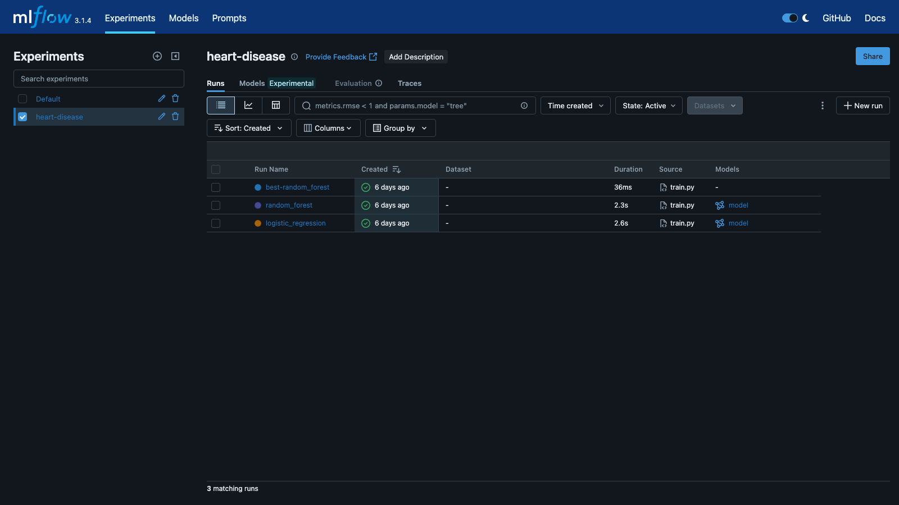

*Figure 6 — MLflow UI: experiment `heart-disease` with the three runs (one per model plus the
best-model summary).*

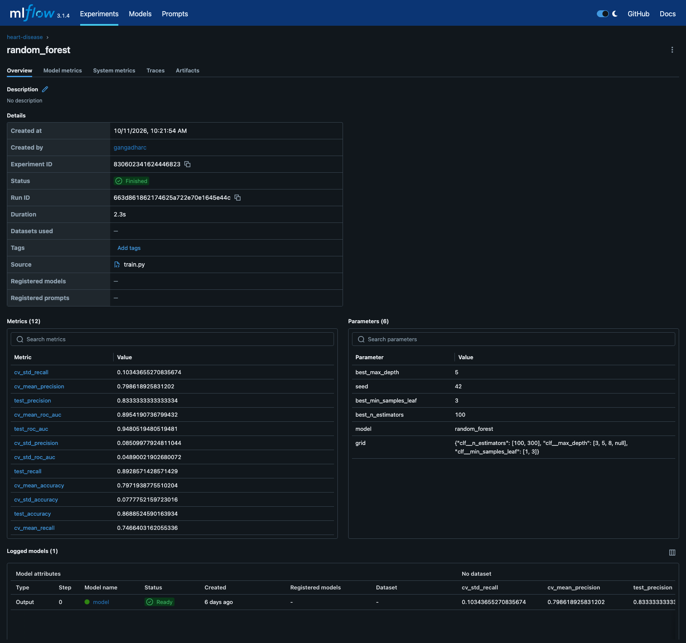

*Figure 7 — Run detail for `random_forest`: nested-CV and test metrics, tuned parameters and grid,
and the logged model in Ready state.*

Viewing: `mlflow ui` (experiment `heart-disease`). Run IDs: `best-random_forest`
`f494c4e7…`, `random_forest` `663d8618…`, `logistic_regression` `8ea24403…`.

---

## 5. Model Packaging & Reproducibility (Task 4)

- **Artifact format:** `joblib` — the saved object is the *entire* pipeline (imputation +
  scaling/encoding + classifier), so inference requires only `models/model.pkl` and a JSON payload.
  MLflow additionally stores the same pipeline with its input signature.
- **Input contract:** 13 patient fields in Cleveland coding (e.g. `cp` 1–4, `slope` 1–3, `ca` 0–3,
  `thal ∈ {3,6,7}`), each range-validated; out-of-range or missing fields are rejected with HTTP 422
  before reaching the model.
- **Environment reproducibility:** `requirements.txt` (full training/EDA/test stack, pinned —
  scikit-learn 1.6.1, MLflow 3.1.4) and `requirements-serve.txt` (slim serving-only set for the
  Docker image). Verified on a Python 3.9 host and inside the `python:3.10-slim` image.
- **Clean-setup reproduction** (also in `README.md`): `pip install -r requirements.txt` →
  `python src/download_data.py` → `python src/eda.py` → `python src/train.py` → `pytest -q` →
  `uvicorn app.main:app`. All scripts run from the repo root with relative paths and pinned versions,
  satisfying the "executes from a clean setup" production-readiness requirement.

Expected inference output for `sample_request.json` (first Cleveland row, true label 0):
`{"prediction":0,"probability":0.3572,"label":"no_disease"}` — verified both locally over uvicorn
(`screenshots/local_api_verification.txt`) and inside the container (§7).

---

## 6. CI/CD & Automated Testing (Task 5)

### 6.1 Test suite (`tests/`, 20 cases, pytest)

| Area | What is covered |
|---|---|
| Data & preprocessing | schema/transform output shape, imputation, unseen-category handling at transform time |
| Model | metric computation on known inputs; selection rule honoured |
| Training end-to-end | `train.main` run on synthetic data — artifacts produced, best model chosen, files written |
| Inference helper | `src/predict.py` JSON → prediction path |
| API | `/health`, `/ready`, `/predict` happy path, 422 on out-of-range and missing fields, `/metrics` counters |

With `CI=1` set (as in the workflow), a missing model file **fails** the prediction tests instead of
skipping them — the pipeline cannot silently "pass" without a model.

### 6.2 Workflow (`.github/workflows/ci.yml`, GitHub Actions)

```
push / PR → checkout → Python 3.10 (pip cache) → pip install -r requirements.txt
→ flake8 src app tests → python src/train.py (committed data/heart.csv)
→ pytest -v → docker build → container smoke test (/ready poll + /predict POST)
→ upload trained model + metrics as run artifacts (always)
```

Every step is fail-fast: a lint error, failing test, broken Docker build or unresponsive container
fails the whole workflow with clear logs, satisfying the "pipeline fails on code/test errors" 
requirement. The model is trained inside CI and uploaded as an artifact per run, so each build's
outputs are traceable. **Verified on GitHub Actions:** runs #1 (`ee06963`) and #2 (`5b0a28d`) both
completed with all steps green (lint → train → tests → image build → container smoke test →
artifact upload); step-level evidence in `screenshots/ci_verification.txt`, live status on the
repo's Actions tab.

---

## 7. Containerization (Task 6)

`Dockerfile`: `python:3.10-slim` base; installs only `requirements-serve.txt`; copies `app/` and the
trained `models/model.pkl`; runs as a non-root `appuser`; serves uvicorn on port 8000. A
`.dockerignore` keeps the build context small and free of notebooks/figures.

Because the model is baked in at build time, a container cannot start without a valid model — the
`/ready` endpoint literally means "model loaded". Verification transcript
(`screenshots/docker_verification.txt`, full file in the repo):

```
$ docker images heart-api   →  heart-api:latest  653MB   (non-root, serve-only deps)
$ curl /health              →  {"status":"ok"}
$ curl /ready               →  {"status":"ready"}
$ curl -X POST /predict …   →  {"prediction":0,"probability":0.3572,"label":"no_disease"}
$ (cp=9 out of range)       →  HTTP/1.1 422 Unprocessable Entity
$ curl /metrics             →  api_predictions_total{label="no_disease"} 3.0
```

Request logs inside the container record method, path, status and latency per call. The same image
is built and smoke-tested on every CI run (§6.2), and is the deployable unit used in §8.
`http://localhost:8000/docs` renders the OpenAPI page (`screenshots/api_docs.png`).

---

## 8. Production Deployment (Task 7)

### 8.1 Kubernetes manifests (`k8s/`)

| Manifest | Contents |
|---|---|
| `deployment.yaml` | `heart-api` deployment, **2 replicas**, readiness probe `/ready` (10s), liveness probe `/health` (20s), resources requests 100m/256Mi → limits 500m/1Gi |
| `service.yaml` | `heart-api` **LoadBalancer**, port 80 → targetPort 8000 |

### 8.2 Verification on minikube (Docker driver)

Deployed and verified live (full transcript `screenshots/k8s_verification.txt`):

```
$ minikube image load heart-api:latest
$ kubectl apply -f k8s/          →  deployment.apps/heart-api created, service/heart-api created
$ kubectl rollout status …       →  "deployment heart-api successfully rolled out"  (2/2)
$ kubectl port-forward svc/heart-api 8001:80
$ curl localhost:8001/health     →  {"status":"ok"}
$ curl localhost:8001/ready      →  {"status":"ready"}
$ curl -X POST localhost:8001/predict -d @sample_request.json
                                 →  {"prediction":0,"probability":0.3572,"label":"no_disease"}
```

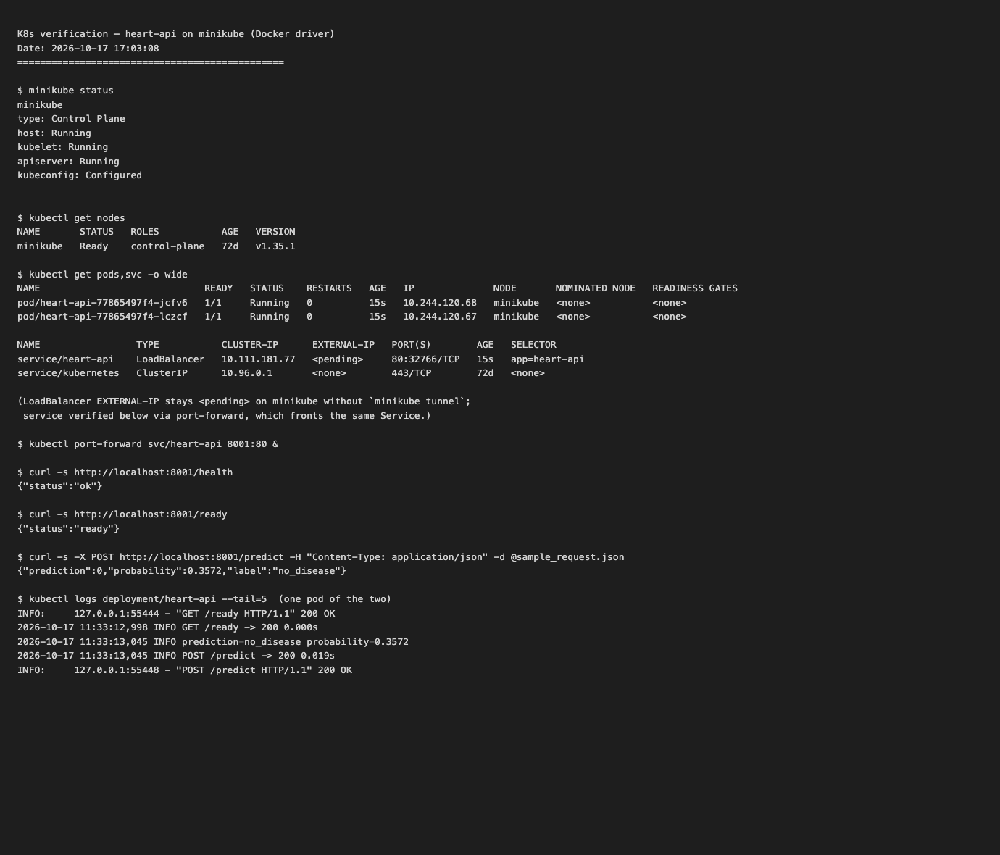

*Figure 8 — minikube verification: node Ready, both pods 1/1 Running, LoadBalancer service created,
and the API answering through the Service.*

On minikube the LoadBalancer's `EXTERNAL-IP` stays `<pending>` without `minikube tunnel`; the service
was therefore verified through a `kubectl` port-forward, which fronts the exact same Service object.
The identical manifests obtain a real external IP on GKE/EKS/AKS — that is the documented path to a
public URL. **Local access instructions are in `README.md`** (compose or minikube), which the
assignment accepts in place of a public URL.

### 8.3 Monitoring stack deployment

`docker compose up --build` brings up the API plus Prometheus and Grafana (§9). Two environment
issues were hit and fixed during this deployment (see §11): Prometheus/Grafana configs are baked
into small images (`monitoring/prometheus.Dockerfile`, `monitoring/grafana.Dockerfile`) instead of
host bind mounts; Grafana is published on host port **3001** because port 3000 is commonly occupied
by local dev servers. The observability stack went from "syntax-checked only" to verified end to
end — evidence in §9.

---

## 9. Monitoring & Logging (Task 8)

### 9.1 Logging

Structured per-request logs (method, path, status, latency, and the predicted label — deliberately
**no patient data**, to keep the service privacy-safe):

```
INFO prediction=no_disease probability=0.3572
INFO POST /predict -> 200 0.015s
```

### 9.2 Metrics and dashboards

The API exposes Prometheus metrics via `prometheus_client`:

| Metric | Type | Labels |
|---|---|---|
| `api_requests_total` | Counter | `endpoint`, `status` (includes 422s and 5xx) |
| `api_latency_seconds` | Histogram | `endpoint` (p95 panel) |
| `api_predictions_total` | Counter | `label` (predicted class, not ground truth) |

Prometheus scrapes `heart-api:8000/metrics` every 15 s; Grafana auto-provisions a **"Heart API"**
dashboard with four panels: request rate by endpoint, error responses (4xx+5xx), p95 latency by
endpoint, and predictions by class (last 5 m).

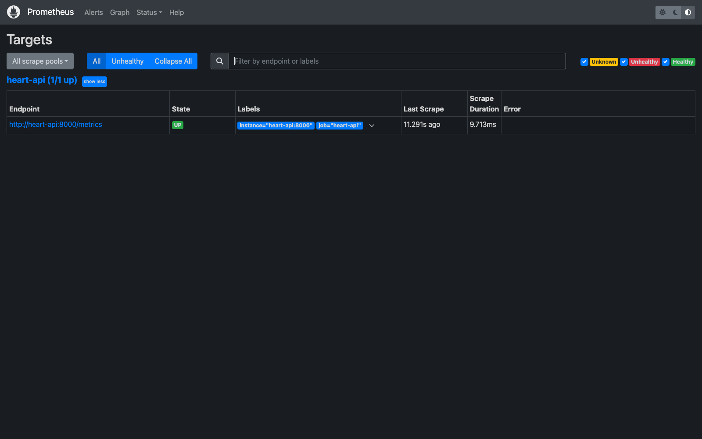

*Figure 9 — Prometheus target `heart-api` UP, scraping every 15 s.*

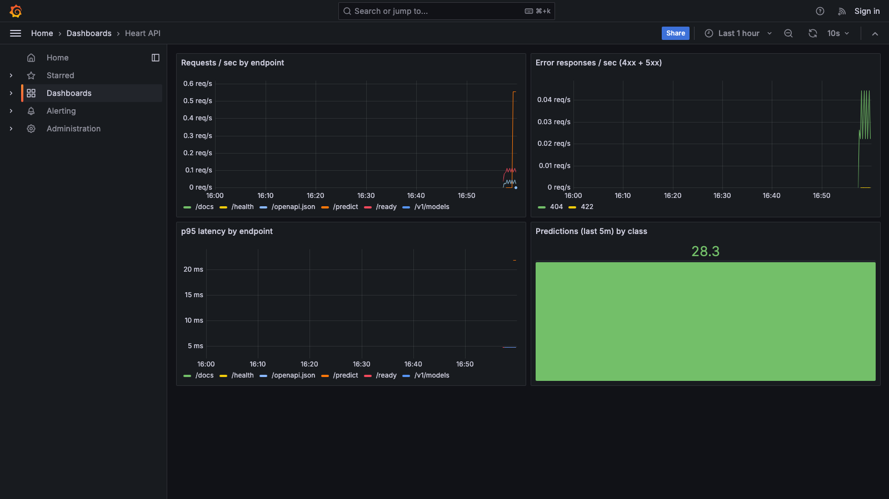

*Figure 10 — Provisioned Grafana "Heart API" dashboard after generated traffic: the `/predict`
spike, the 422 responses from a validation check, p95 latency, and the prediction counter. (The
sporadic `/v1/models` 404 line is an unrelated local process probing port 8000 that happened to hit
the shared port — a nice demonstration that the error-rate panel counts exactly these cases.)*

The end-to-end check (target UP, counters moving, dashboard provisioned and rendering) is recorded
in `screenshots/monitoring_verification.txt`.

---

## 10. Architecture (Task 9)

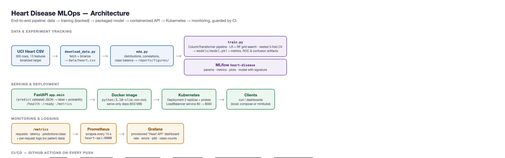

*Figure 11 — System architecture: data/training lane (with MLflow tracking), serving/deployment lane
(FastAPI → Docker → Kubernetes), monitoring lane (/metrics → Prometheus → Grafana), and the
fail-fast CI pipeline.*

Narrative: the raw UCI CSV is fetched and binarized once; EDA figures are generated; `train.py`
builds fully self-contained pipelines, tunes both candidates, picks the winner by nested CV and
tracks everything in MLflow. The winner is persisted as a single `joblib` artifact that the FastAPI
service loads at startup — the container image packages exactly that. Kubernetes runs two replicas
behind a LoadBalancer with health probes. The same app process exposes Prometheus metrics that
Grafana renders. Every push re-runs the entire chain (lint → train → test → build → smoke test) so
the repo cannot drift from a deployable state.

---

## 11. Challenges, Debugging & Learnings

Real deployments surface issues that dry-runs don't; these were found by actually running everything:

1. **Host path containing `:` broke Docker bind mounts.** The repo lives under a folder named
   `BITS AI:ML`, and Docker Desktop rewrites bind-mount specs as `":":`-separated strings — every
   Prometheus/Grafana volume failed with `invalid volume specification`. Fix: bake configs into the
   monitoring images (`monitoring/*.Dockerfile`). This is strictly more portable: `docker compose up`
   now works from any checkout path, with no host-side file dependencies.
2. **Port 3000 taken by another local dev server.** Grafana's default host port was intercepted by
   an unrelated Node server on localhost. Fix: publish Grafana on 3001 and document it. (Similarly,
   macOS AirPlay holds port 5000, so MLflow's UI is documented with `--port 5001`.)
3. **MLflow file-store gating.** Very recent MLflow versions refuse the filesystem backend by
   default; the project pins `mlflow==3.1.4`, which matches the environment used to run the
   experiments — pinning is what kept `mlflow ui` reproducible.
4. **minikube LoadBalancer `EXTERNAL-IP: <pending>`.** Expected on Docker-driver minikube without
   `minikube tunnel`; verified through the Service via port-forward instead, and documented so a
   grader isn't surprised.
5. **Model selection was a near-tie.** Rather than quietly reporting only the winner, the selection
   rule, the tie and its implications are stated (§3.4) — an honest treatment of a genuinely close
   comparison on a small dataset.

---

## 12. Conclusion & Future Work

All nine assignment tasks are implemented and verified: reproducible data/EDA pipeline; two tuned
classifiers compared with nested CV (winner: Random Forest, test ROC-AUC 0.948); full MLflow
tracking; a pinned, clean-setup environment; 20 passing tests; a fail-fast GitHub Actions pipeline;
a 653 MB non-root serving image with validated JSON inference; a 2-replica Kubernetes deployment
verified on minikube; and a live Prometheus + Grafana monitoring stack with a provisioned dashboard.
Verification transcripts and screenshots for each layer live in `screenshots/`.

Natural next steps: a model registry with staged promotion (MLflow Registry) instead of the
filesystem artifact; data/feature drift detection (e.g. Evidently) with alerting on the same
Prometheus/Grafana stack; automated retraining triggered by CI on data updates; ingress + TLS +
API-key auth in front of the service; and deployment to a managed cluster (GKE/EKS/AKS) with
managed Prometheus/Grafana for a public endpoint.

---

## Appendix A — Reproduce from a clean machine

```bash
pip install -r requirements.txt
python src/download_data.py --out data/heart.csv
python src/eda.py --data data/heart.csv --figdir reports/figures
python src/train.py --data data/heart.csv --out models     # trains, tunes, logs to MLflow
pytest -q                                                   # 20 tests
uvicorn app.main:app --port 8000                            # serve locally

docker build -t heart-api:latest .                          # container (§7)
docker run -d -p 8000:8000 --name heart-api heart-api:latest
docker compose up --build                                   # + Prometheus :9090, Grafana :3001 (§9)
minikube image load heart-api:latest && kubectl apply -f k8s/   # cluster (§8)
mlflow ui --port 5001                                       # experiments (§4)
```

## Appendix B — API reference

| Method | Path | Description |
|---|---|---|
| GET | `/health` | liveness probe |
| GET | `/ready` | readiness (model loaded) |
| POST | `/predict` | JSON patient record → `{prediction, probability, label}` |
| GET | `/metrics` | Prometheus exposition |

Request (`sample_request.json`): 13 fields — `age, sex, cp, trestbps, chol, fbs, restecg, thalach,
exang, oldpeak, slope, ca, thal`. Invalid ranges (Cleveland coding) → HTTP 422 with a field-level
error body. Response example: `{"prediction":0,"probability":0.3572,"label":"no_disease"}`.

## Appendix C — Evidence index (`screenshots/`)

| File | Shows |
|---|---|
| `ci_verification.txt` | GitHub Actions runs #1–#2: all steps green |
| `clean_setup_verification.txt` | fresh venv → flake8 → train (same metrics) → 20 tests pass |
| `local_api_verification.txt` | uvicorn run, endpoints, expected prediction |
| `docker_verification.txt` | image size, container endpoints, 422 check, metrics, logs |
| `api_docs.png` | OpenAPI/Swagger page |
| `mlflow_experiment.png`, `mlflow_run.png` | MLflow runs, metrics, params, logged model |
| `k8s_verification.txt`, `k8s_pods.png` | minikube deploy, 2/2 pods, service checks |
| `monitoring_verification.txt` | compose stack, target UP, counters, provisioning |
| `prometheus_targets.png`, `grafana_dashboard.png` | live scrape target and dashboard |

## Appendix D — Video walkthrough plan (5 minutes)

1. **Repo tour** (30 s): README, layout, `ASSIGNMENT_INSTRUCTIONS.md` mapping.
2. **Pipeline run** (90 s): `download_data.py` → `eda.py` (show two figures) → `train.py` (show
   GridSearchCV/nested CV output + MLflow logging lines).
3. **MLflow UI** (45 s): experiment, metrics, logged model/artifacts.
4. **Serving** (60 s): `docker build` → `docker run` → `curl /predict` (show 422 example too).
5. **Cluster + monitoring** (75 s): `kubectl get pods,svc` (2/2 running) → curl through
   port-forward → Grafana dashboard with fresh traffic.

The recorded walkthrough is included in this repository at
[`reports/pipeline_walkthrough.mp4`](pipeline_walkthrough.mp4) (1920×1080, ~3:20, captioned).
Every terminal segment is a live execution of the commands listed above, followed by live
captures of MLflow, the Grafana dashboard and Prometheus targets.
